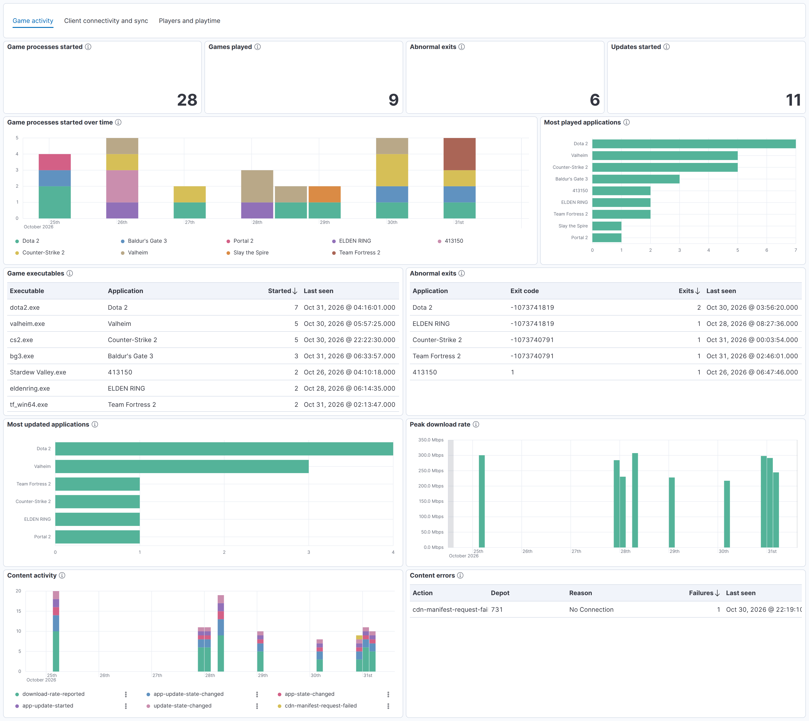
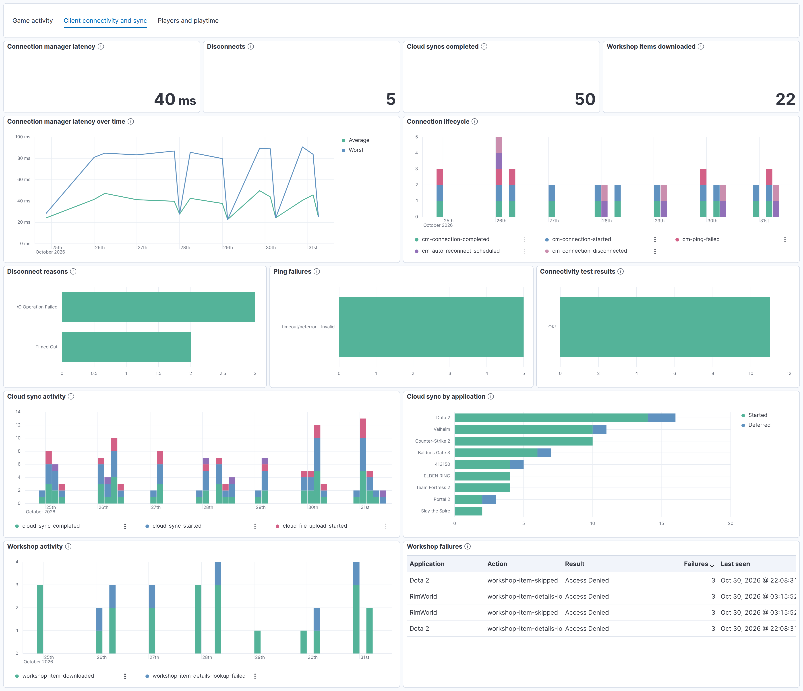
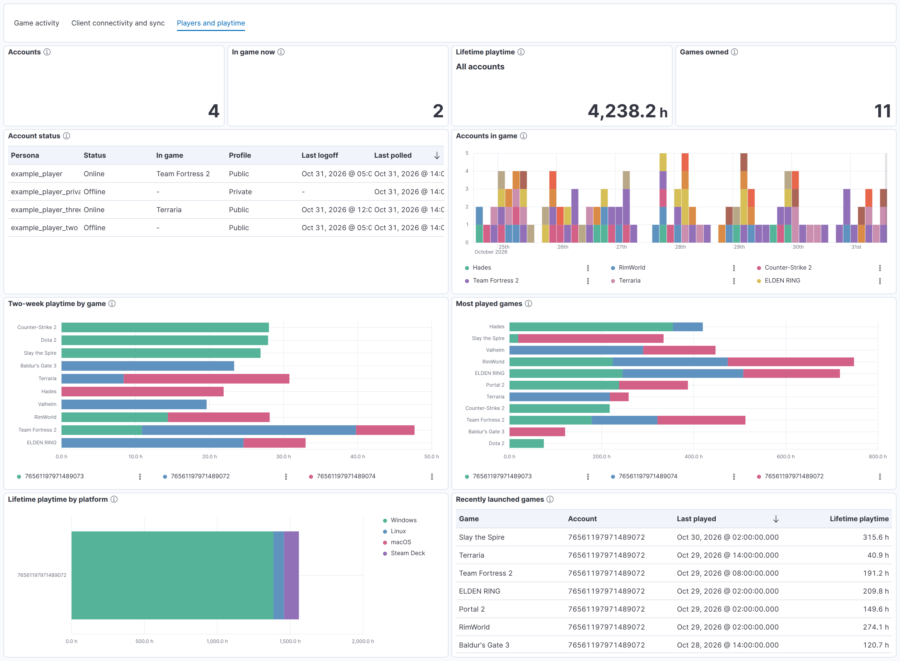

# Steam Integration for Elastic

[](https://github.com/NateShoffner/elastic-integration-steam/actions/workflows/ci.yml)

An Elastic Agent integration for [Steam](https://store.steampowered.com) that
collects game launches and exits (`gameprocess`), downloads and updates
(`content`), Steam Cloud sync (`cloud`), client connectivity (`connection`) and
Workshop activity (`workshop`) from the Steam client logs, plus presence
(`player_summary`) and playtime (`recently_played`, `owned_game`) from the
Steam Web API.

Client logs are tailed with the filestream input on the machine running Steam;
the Web API is polled with the CEL input and needs a free
[Steam Web API key](https://steamcommunity.com/dev/apikey). Both share
`steam.app.id` and `steam.player.id`, so the two can be joined. Requires
**Kibana 8.19.2 or later**.

**[Read the integration documentation](packages/steam/docs/README.md)** for
setup steps, configuration options, exported fields, and troubleshooting.

## Dashboards

Game activity, client connectivity and sync, and players and playtime, shown
here with synthetic data:







## Installation

Download the `.zip` from the [latest release](https://github.com/NateShoffner/elastic-integration-steam/releases/latest)
and upload it through **Kibana > Integrations > Upload integration**, or:

```sh
elastic-package install --zip steam-<version>.zip
```

To build it yourself instead:

```sh
cd packages/steam
elastic-package build     # writes build/packages/steam-<version>.zip
elastic-package install
```

## Development

Requires [`elastic-package`](https://github.com/elastic/elastic-package) and
Docker. Run from `packages/steam`:

```sh
elastic-package check            # lint and build
elastic-package stack up -d -v   # needed by the test commands below
elastic-package test pipeline    # ingest pipeline tests
elastic-package test system      # end-to-end against mock logs and a mock Web API
```

Edit documentation in `_dev/build/docs/README.md`, never in `docs/README.md`,
which is regenerated on every build. Dashboards in `kibana/dashboard/` are
generated by `tools/dashboards/build_dashboards.py`; edit the script and rerun
it rather than editing the JSON.

`samples/` holds anonymized client logs, one per log data stream, that the
pipeline and system test fixtures are drawn from. Raw captures go in
`samples/private/`, which is gitignored. Never commit them.

### Releasing

Bump `version` in `packages/steam/manifest.yml`, add a matching
`changelog.yml` entry, then push a tag:

```sh
git tag v0.2.0 && git push origin v0.2.0
```

CI verifies the tag matches the manifest version, runs the tests, builds the
package, and publishes a GitHub release with the `.zip` attached, a build
provenance attestation, and notes drawn from the changelog entry.

Both CI and the release run on the shared reusable workflows in
[`NateShoffner/elastic-package-workflows`](https://github.com/NateShoffner/elastic-package-workflows).

## License

[Elastic License 2.0](LICENSE). Steam and Valve are trademarks of Valve
Corporation. This project is not affiliated with Valve or Elastic.
